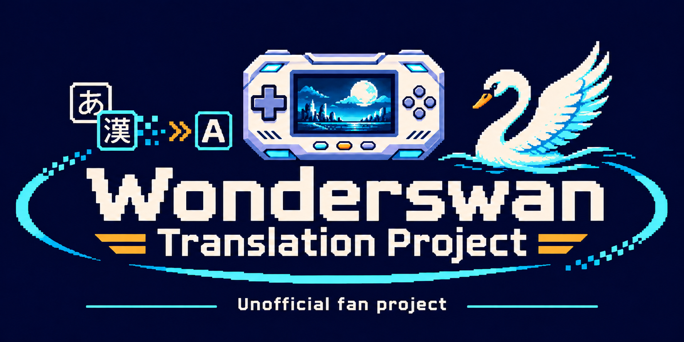

# WonderSwanColor-AI_Translation
Translations made by Claude - Opus 5.5

<!-- patch-list:start -->
## WonderSwan translation patches — newest first

Every `.bps` / `.ips` WonderSwan translation patch found by [WonderSwan_bps_repo](https://github.com/mariovirgili/WonderSwan_bps_repo) (mariovirgili, Cloogr, Gand46), catalog of 2026-11-11: the newest version of each translation, 86 releases. A game translated by more than one author appears once for each. Gand46 publishes his patches as files in his repositories: one row per repository, with its latest files. This list is updated automatically after each catalog update.

| Date | Author | Game | Release | Patch files | Language |
| --- | --- | --- | --- | --- | --- |
| 2026-11-11 | [mariovirgili](https://github.com/mariovirgili/WonderSwanColor-AI_Translation) | Saint Seiya - Ougon Densetsu Hen - Perfect Edition | [[Release] Saint Seiya - Ougon Densetsu Hen - Perfect Edition (WonderSwan Color) - English v0.9](https://github.com/mariovirgili/WonderSwanColor-AI_Translation/releases/tag/SaintSeiya_0.9) | Saint.Seiya.-.Ougon.Densetsu.Hen.-.Perfect.Edition.EN.v0.9.ALL.CAPS, Saint.Seiya.-.Ougon.Densetsu.Hen.-.Perfect.Edition.EN.v0.9 | English |
| 2026-11-11 | [mariovirgili](https://github.com/mariovirgili/WonderSwanColor-AI_Translation) | SD Gundam Eiyuu Den - Musha Densetsu | [[Release] SD Gundam Eiyuu Den - Musha Densetsu (WonderSwan Color) - English v0.9](https://github.com/mariovirgili/WonderSwanColor-AI_Translation/releases/tag/MushaDensetsu_0.9) | SD.Gundam.Eiyuu.Den.-.Musha.Densetsu.EN.v0.9 | English |
| 2026-11-11 | [mariovirgili](https://github.com/mariovirgili/WonderSwanColor-AI_Translation) | SD Gundam Eiyuu Den - Kishi Densetsu | [[Release] SD Gundam Eiyuu Den - Kishi Densetsu (WonderSwan Color) - English v0.9](https://github.com/mariovirgili/WonderSwanColor-AI_Translation/releases/tag/KishiDensetsu_0.9) | SD.Gundam.Eiyuu.Den.-.Kishi.Densetsu.EN.v0.9 | English |
| 2026-11-10 | [Cloogr](https://github.com/PokemonGoDB/wonderswan-english-patches) | Another Heaven: Memory of those Days | [[Release] Another Heaven: Memory of those Days (WonderSwan Color) - AI English translation patch v1.1](https://github.com/PokemonGoDB/wonderswan-english-patches/releases/tag/another-heaven-v1.1) | another-heaven-en-1.1 | English |
| 2026-11-09 | [mariovirgili](https://github.com/mariovirgili/WonderSwanColor-AI_Translation) | Time Bokan Series - Bokan Densetsu - Buta mo Odaterya Doronboo | [[Release] Time Bokan Series - Bokan Densetsu - Buta mo Odaterya Doronboo (WonderSwan) - English v0.9.2](https://github.com/mariovirgili/WonderSwanColor-AI_Translation/releases/tag/BokanDensetsu_0.9) | Time.Bokan.Series.-.Bokan.Densetsu.-.Buta.mo.Odaterya.Doronboo.EN.v0.9.2 | English |
| 2026-11-09 | [Cloogr](https://github.com/PokemonGoDB/wonderswan-english-patches) | Star Hearts: Hoshi to Daichi no Shisha | [[Release] Star Hearts: Hoshi to Daichi no Shisha (WonderSwan Color) - AI English translation patch v1.2](https://github.com/PokemonGoDB/wonderswan-english-patches/releases/tag/star-hearts-v1.2) | star-hearts-en-1.2 | English |
| 2026-11-09 | [Cloogr](https://github.com/PokemonGoDB/wonderswan-english-patches) | Chou Denki Card Battle: Youfu Makai | [[Release] Chou Denki Card Battle: Youfu Makai (WonderSwan) - AI English translation patch v1.1](https://github.com/PokemonGoDB/wonderswan-english-patches/releases/tag/youfu-makai-v1.1) | youfu-makai-en-1.1 | English |
| 2026-11-09 | [Cloogr](https://github.com/PokemonGoDB/wonderswan-english-patches) | Bakusou Dekotora Densetsu for WonderSwan | [[Release] Bakusou Dekotora Densetsu for WonderSwan (WonderSwan) - AI English translation patch v1.2 (+ special edition, may be buggy)](https://github.com/PokemonGoDB/wonderswan-english-patches/releases/tag/dekotora-v1.2) | dekotora-en-1.2, dekotora-en-special-1.2 | English |
| 2026-11-09 | [mariovirgili](https://github.com/mariovirgili/WonderSwanColor-AI_Translation) | Judgement Silversword | [[Mod] Judgement Silversword - Rebirth Edition: ARRANGE EDITION v2.7 (WonderSwan Color)](https://github.com/mariovirgili/WonderSwanColor-AI_Translation/releases/tag/JSS_Arrange_2.7) | JSS_Arrange_v2_7, JSS_Normal+Arrange_v2_7 | English |
| 2026-11-08 | [mariovirgili](https://github.com/mariovirgili/WonderSwanColor-AI_Translation) | Alchemist Marie & Elie: Futari no Atelier | [[WonderSwan Color] Alchemist Marie & Elie: Futari no Atelier – English translation patch v0.9.3 (AI-made, personal project)](https://github.com/mariovirgili/WonderSwanColor-AI_Translation/releases/tag/AtelierMarieElie_0.9.2) | Alchemist.Marie.Elie.-.Futari.no.Atelier.T-En.v0.9.3 | English |
| 2026-11-08 | [mariovirgili](https://github.com/mariovirgili/WonderSwanColor-AI_Translation) | Giren no Yabou Tokubetsu Hen: Aoki Hoshi no Hasha | [[WSC] Giren no Yabou Tokubetsu Hen: Aoki Hoshi no Hasha – English translation patch v0.9 (AI translation)](https://github.com/mariovirgili/WonderSwanColor-AI_Translation/releases/tag/Giren_0.9) | Giren.no.Yabou.-.Aoki.Hoshi.no.Hasha.English.v0.9.ALL.CAPS, Giren.no.Yabou.-.Aoki.Hoshi.no.Hasha.English.v0.9 | English |
| 2026-11-08 | [mariovirgili](https://github.com/mariovirgili/WonderSwanColor-AI_Translation) | Uchuu Senkan Yamato | [[Release] Uchuu Senkan Yamato (WonderSwan Color) - English translation patch v0.9](https://github.com/mariovirgili/WonderSwanColor-AI_Translation/releases/tag/UchuuSenkanYamato_0.9) | Uchuu.Senkan.Yamato.EN.v0.9 | English |
| 2026-11-08 | [mariovirgili](https://github.com/mariovirgili/WonderSwanColor-AI_Translation) | Tetsujin 28 Gou | [[Release] Tetsujin 28 Gou (WonderSwan) - English v0.9](https://github.com/mariovirgili/WonderSwanColor-AI_Translation/releases/tag/Tetsujin28_0.9) | Tetsujin.28.Gou.EN.v0.9 | English |
| 2026-11-08 | [mariovirgili](https://github.com/mariovirgili/WonderSwanColor-AI_Translation) | Side Pocket for WonderSwan | [[Release] Side Pocket for WonderSwan - English v0.9.1, now also in 16 colours for the WonderSwan Color](https://github.com/mariovirgili/WonderSwanColor-AI_Translation/releases/tag/SidePocket_0.9.1) | Side.Pocket.for.WonderSwan.Color.EN.v0.9.1, Side.Pocket.for.WonderSwan.EN.v0.9.1 | English |
| 2026-11-08 | [Cloogr](https://github.com/PokemonGoDB/wonderswan-english-patches) | SD Gundam G Generation: Gather Beat 2 | [[Release] SD Gundam G Generation: Gather Beat 2 (WonderSwan Color) - AI English translation patch v1.3 (+ Stage Select edition)](https://github.com/PokemonGoDB/wonderswan-english-patches/releases/tag/gather-beat-2-v1.3) | gather-beat-gb2-en-1.3, gather-beat-gb2-en-stagesel-1.3 | English |
| 2026-11-08 | [mariovirgili](https://github.com/mariovirgili/WonderSwanColor-AI_Translation) | SD Gundam G Generation - Mono-Eye Gundams | [[Release] SD Gundam G Generation - Mono-Eye Gundams (WonderSwan Color) - English v0.9.1](https://github.com/mariovirgili/WonderSwanColor-AI_Translation/releases/tag/MonoEyeGundams_0.9.1) | SD.Gundam.G.Generation.-.Mono-Eye.Gundams.EN.v0.9.1 | English |
| 2026-11-08 | [mariovirgili](https://github.com/mariovirgili/WonderSwanColor-AI_Translation) | Puzzle Bobble | [[Release] Puzzle Bobble (WonderSwan) - English translation + colorization patch v0.9.5](https://github.com/mariovirgili/WonderSwanColor-AI_Translation/releases/tag/PuzzleBobble_0.9.5) | Puzzle.Bobble.Japan.T-En.v0.9.5.16.colours | English |
| 2026-11-08 | [mariovirgili](https://github.com/mariovirgili/WonderSwanColor-AI_Translation) | Namco Super Wars | [[Release] Namco Super Wars (WonderSwan Color) - English translation patch v0.9.1](https://github.com/mariovirgili/WonderSwanColor-AI_Translation/releases/tag/NamcoSuperWars_0.9.1) | Namco.Super.Wars.T-En.v0.9.1.All.Caps, Namco.Super.Wars.T-En.v0.9.1 | English |
| 2026-11-08 | [mariovirgili](https://github.com/mariovirgili/WonderSwanColor-AI_Translation) | Macross - True Love Song | [[Release] Macross - True Love Song (WonderSwan) - English v0.9](https://github.com/mariovirgili/WonderSwanColor-AI_Translation/releases/tag/MacrossTLS_0.9) | Macross.-.True.Love.Song.EN.v0.9 | English |
| 2026-11-08 | [mariovirgili](https://github.com/mariovirgili/WonderSwanColor-AI_Translation) | Kaze no Klonoa: Moonlight Museum | [[Release] Kaze no Klonoa: Moonlight Museum (WonderSwan Color) – colorization + new English translation (4 colours v0.9 + 16-colour beta)](https://github.com/mariovirgili/WonderSwanColor-AI_Translation/releases/tag/Klonoa_MM_0.9) | Kaze.no.Klonoa.-.Moonlight.Museum.Japan.16.colours.TEST.v39.4MB.EN.v0.8 | English |
| 2026-11-08 | [mariovirgili](https://github.com/mariovirgili/WonderSwanColor-AI_Translation) | Hunter X Hunter: Sorezore no Ketsui | [[Release] Hunter X Hunter: Sorezore no Ketsui (WonderSwan Color) - English translation patch v0.9](https://github.com/mariovirgili/WonderSwanColor-AI_Translation/releases/tag/HxH_SorezoreNoKetsui_0.9) | Hunter.X.Hunter.-.Sorezore.no.Ketsui.T-En.v0.9 | English |
| 2026-11-08 | [mariovirgili](https://github.com/mariovirgili/WonderSwanColor-AI_Translation) | Hanjuku Hero: Ah, Sekai yo Hanjuku Nare...!! | [[Release] Hanjuku Hero: Ah, Sekai yo Hanjuku Nare...!! (WonderSwan Color) - English translation patch v0.9](https://github.com/mariovirgili/WonderSwanColor-AI_Translation/releases/tag/HanjukuHero_0.9) | Hanjuku.Hero.-.Ah.Sekai.yo.Hanjuku.Nare.T-En.v0.9 | English |
| 2026-11-08 | [mariovirgili](https://github.com/mariovirgili/WonderSwanColor-AI_Translation) | Gensou Maden Saiyuuki Retribution - Hi no Ataru Basho de | [[Release] Gensou Maden Saiyuuki Retribution - Hi no Ataru Basho de (WonderSwan Color) - English v0.9](https://github.com/mariovirgili/WonderSwanColor-AI_Translation/releases/tag/GensouMaden_0.9) | Gensou.Maden.Saiyuuki.Retribution.-.Hi.no.Ataru.Basho.de.EN.v0.9 | English |
| 2026-11-08 | [mariovirgili](https://github.com/mariovirgili/WonderSwanColor-AI_Translation) | Final Lap Special - GT & Formula Machine | [[Release] Final Lap Special - GT & Formula Machine (WonderSwan Color) - English translation patch v0.9.1](https://github.com/mariovirgili/WonderSwanColor-AI_Translation/releases/tag/FinalLapSpecial_0.9.1) | Final.Lap.Special.-.GT.Formula.Machine.T-En.v0.9.1 | English |
| 2026-11-08 | [mariovirgili](https://github.com/mariovirgili/WonderSwanColor-AI_Translation) | Final Fantasy II | [[Release] Final Fantasy II (WonderSwan Color) - English translation patch v0.9.2](https://github.com/mariovirgili/WonderSwanColor-AI_Translation/releases/tag/FFII_0.9.2) | Final.Fantasy.II.T-En.v0.9.2.Big.Caps, Final.Fantasy.II.T-En.v0.9.2 | English |
| 2026-11-08 | [mariovirgili](https://github.com/mariovirgili/WonderSwanColor-AI_Translation) | Dragon Ball | [[Release] Dragon Ball (WonderSwan Color) - English translation patch v0.9](https://github.com/mariovirgili/WonderSwanColor-AI_Translation/releases/tag/DragonBall_0.9) | Dragon.Ball.T-En.v0.9 | English |
| 2026-11-08 | [mariovirgili](https://github.com/mariovirgili/WonderSwanColor-AI_Translation) | Digimon Tamers: Digimon Medley | [[Release] Digimon Tamers: Digimon Medley (WonderSwan Color) - English translation patch v0.9.2](https://github.com/mariovirgili/WonderSwanColor-AI_Translation/releases/tag/DigimonMedley_0.9.2) | Digimon.Tamers.-.Digimon.Medley.EN.v0.9.2 | English |
| 2026-11-08 | [mariovirgili](https://github.com/mariovirgili/WonderSwanColor-AI_Translation) | Densha de Go! 2 | [[Release] Densha de Go! 2 (WonderSwan) - English v0.9.1](https://github.com/mariovirgili/WonderSwanColor-AI_Translation/releases/tag/DenshaDeGo2_0.9.1) | Densha.de.Go.2.EN.v0.9.1 | English |
| 2026-11-08 | [mariovirgili](https://github.com/mariovirgili/WonderSwanColor-AI_Translation) | Arc the Lad: Kijin Fukkatsu | [[Release] Arc the Lad: Kijin Fukkatsu (WonderSwan Color) - English translation patch v0.9](https://github.com/mariovirgili/WonderSwanColor-AI_Translation/releases/tag/ArcTheLad_0.9) | Arc.the.Lad.-.Kijin.Fukkatsu.T-En.v0.9 | English |
| 2026-11-08 | [mariovirgili](https://github.com/mariovirgili/WonderSwanColor-AI_Translation) | Bishoujo Senshi Sailor Moon S | [[Game Gear] Bishoujo Senshi Sailor Moon S – English translation v0.9 (AI-made)](https://github.com/mariovirgili/WonderSwanColor-AI_Translation/releases/tag/SailorMoonS_GG_0.9) | Bishoujo.Senshi.Sailor.Moon.S.Japan.EN.v0.9 | English |
| 2026-11-02 | [Gand46](https://github.com/Gand46/StarHearts-Wonderswan-English-Translation-AI_GPT) | Star Hearts: Hoshi to Daichi no Shisha | [StarHearts-Wonderswan-English-Translation-AI_GPT (repository)](https://github.com/Gand46/StarHearts-Wonderswan-English-Translation-AI_GPT) | StarHearts_EN_phase13BG_F37_CUMULATIVE_FROM_JP | English |
| 2026-11-02 | [Gand46](https://github.com/Gand46/Rockman-EXE-N1-Battle-ChipControl-Wonderswan-English-Translation-AI_GPT) | Rockman EXE N1 Battle ChipControl | [Rockman-EXE-N1-Battle-ChipControl-Wonderswan-English-Translation-AI_GPT (repository)](https://github.com/Gand46/Rockman-EXE-N1-Battle-ChipControl-Wonderswan-English-Translation-AI_GPT) | Rockman_N1_English_QA09_MANT05 | English |
| 2026-11-02 | [Gand46](https://github.com/Gand46/Riviera-Wonderswan-English-Translation-AI_GPT) | Riviera | [Riviera-Wonderswan-English-Translation-AI_GPT (repository)](https://github.com/Gand46/Riviera-Wonderswan-English-Translation-AI_GPT) | Riviera_CLEAN_JP_to_v0110_S457_cumulative | English |
| 2026-11-02 | [Gand46](https://github.com/Gand46/MakaiMura-EEPROM-Wonderswan-English-Translation-AI_GPT-) | MakaiMura EEPROM | [MakaiMura-EEPROM-Wonderswan-English-Translation-AI_GPT- (repository)](https://github.com/Gand46/MakaiMura-EEPROM-Wonderswan-English-Translation-AI_GPT-) | Makaimura_HF20_EEPROM_v1_FROM_HF20, Makaimura_HF20_EEPROM_v1_FROM_JP | English |
| 2026-11-02 | [Gand46](https://github.com/Gand46/Front-Mission-Wonderswan-English-Translation-AI_GPT) | Front Mission | [Front-Mission-Wonderswan-English-Translation-AI_GPT (repository)](https://github.com/Gand46/Front-Mission-Wonderswan-English-Translation-AI_GPT) | baseline_v033_from_clean, v033_TEST_from_v032, v034_TEST_from_v033, v035_TEST_from_clean | English |
| 2026-11-02 | [Gand46](https://github.com/Gand46/Densha-de-Go-2-Wonderswan-English-Translation-AI_GPT) | Densha de Go 2 / Densha de Go! 2 | [Densha-de-Go-2-Wonderswan-English-Translation-AI_GPT (repository)](https://github.com/Gand46/Densha-de-Go-2-Wonderswan-English-Translation-AI_GPT) | Densha_de_Go_2_EN_v0.4.17_from_v0.4.16_INCREMENTAL, baseline_v0416_cumulative, Densha_de_Go_2_EN_v0.4.20_OPTIONS_FONT_CUMULATIVE | English |
| 2026-11-02 | [Gand46](https://github.com/Gand46/Chocobo_no_Fushigi_na_Dungeon_Mysterious_Dungeon_WS_AI_ROM-FIX-) | Chocobo no Fushigi na Dungeon Mysterious Dungeon | [Chocobo_no_Fushigi_na_Dungeon_Mysterious_Dungeon_WS_AI_ROM-FIX- (repository)](https://github.com/Gand46/Chocobo_no_Fushigi_na_Dungeon_Mysterious_Dungeon_WS_AI_ROM-FIX-) | legacy_v1.1_original |  |
| 2026-11-02 | [Gand46](https://github.com/Gand46/BlueWingBlitz-Wonderswan-English-Translation-AI_GPT) | Blue Wing Blitz | [BlueWingBlitz-Wonderswan-English-Translation-AI_GPT (repository)](https://github.com/Gand46/BlueWingBlitz-Wonderswan-English-Translation-AI_GPT) | Blue_Wing_Blitz_EN_Phase50_v5.0.0-test.1 | English |
| 2026-10-17 | [mariovirgili](https://github.com/mariovirgili/WonderSwanColor-AI_Translation) | Final Fantasy | [[Release] Final Fantasy (WonderSwan Color) - English translation patch v0.9](https://github.com/mariovirgili/WonderSwanColor-AI_Translation/releases/tag/FFI_v0.9) | Final Fantasy [T-En v0.9] | English |
| 2026-10-15 | [Cloogr](https://github.com/PokemonGoDB/wonderswan-english-patches) | Tare Panda no GunPey | [[Release] Tare Panda no GunPey (WonderSwan) - AI English translation patch v1.0 (+ debug edition)](https://github.com/PokemonGoDB/wonderswan-english-patches/releases/tag/tare-panda-gunpey-v1.0) | tare-panda-gunpey-en-1.0, tare-panda-gunpey-en-debug-1.0, tare-panda-gunpey-en-wondergate-1.0 | English |
| 2026-10-15 | [Cloogr](https://github.com/PokemonGoDB/wonderswan-english-patches) | Sennou Millennium | [[Release] Sennou Millennium (WonderSwan) - AI English translation patch v1.0 (+ special edition)](https://github.com/PokemonGoDB/wonderswan-english-patches/releases/tag/sennou-millennium-v1.0) | sennou-millennium-en-1.0, sennou-millennium-en-special-1.0 | English |
| 2026-10-15 | [Cloogr](https://github.com/PokemonGoDB/wonderswan-english-patches) | SD Gundam G Generation: Gather Beat | [[Release] SD Gundam G Generation: Gather Beat (WonderSwan) - AI English translation patch v1.2](https://github.com/PokemonGoDB/wonderswan-english-patches/releases/tag/gather-beat-v1.2) | gather-beat-gb1-en-1.2 | English |
| 2026-10-15 | [Cloogr](https://github.com/PokemonGoDB/wonderswan-english-patches) | Ring Infinity | [[Release] Ring Infinity (WonderSwan) - AI English translation patch v1.1 (+ special edition)](https://github.com/PokemonGoDB/wonderswan-english-patches/releases/tag/ring-infinity-v1.1) | ring-infinity-en-1.1, ring-infinity-en-special-1.1 | English |
| 2026-10-15 | [Cloogr](https://github.com/PokemonGoDB/wonderswan-english-patches) | Pocket Fighter | [[Release] Pocket Fighter (WonderSwan) - AI English translation patch v1.0](https://github.com/PokemonGoDB/wonderswan-english-patches/releases/tag/pocket-fighter-v1.0) | pocket-fighter-en-1.0, pocket-fighter-en-extras-1.0 | English |
| 2026-10-15 | [Cloogr](https://github.com/PokemonGoDB/wonderswan-english-patches) | MobileWonderGate | [[Release] MobileWonderGate (WonderSwan) - AI English translation patch v1.0](https://github.com/PokemonGoDB/wonderswan-english-patches/releases/tag/mobile-wondergate-v1.0) | mobile-wondergate-en-1.0 | English |
| 2026-10-15 | [Cloogr](https://github.com/PokemonGoDB/wonderswan-english-patches) | Lode Runner for WonderSwan | [[Release] Lode Runner for WonderSwan (WonderSwan) - AI English translation patch v1.0 (+ Swan Revival Edition)](https://github.com/PokemonGoDB/wonderswan-english-patches/releases/tag/lode-runner-v1.0) | lode-runner-en-1.0, lode-runner-se-en-1.0, lode-runner-se-ja-1.0 | English, Japanese |
| 2026-10-15 | [Cloogr](https://github.com/PokemonGoDB/wonderswan-english-patches) | Kidou Senshi Gundam Vol. 3: A Baoa Qu | [[Release] Kidou Senshi Gundam Vol. 3: A Baoa Qu (WonderSwan Color) - AI English translation patch v1.1](https://github.com/PokemonGoDB/wonderswan-english-patches/releases/tag/gundam-vol3-a-baoa-qu-v1.1) | gundam-vol3-a-baoa-qu-en-1.1 | English |
| 2026-10-15 | [Cloogr](https://github.com/PokemonGoDB/wonderswan-english-patches) | Kidou Senshi Gundam Vol. 2: Jaburo | [[Release] Kidou Senshi Gundam Vol. 2: Jaburo (WonderSwan Color) - AI English translation patch v1.1](https://github.com/PokemonGoDB/wonderswan-english-patches/releases/tag/gundam-vol2-jaburo-v1.1) | gundam-vol2-jaburo-en-1.1 | English |
| 2026-10-15 | [Cloogr](https://github.com/PokemonGoDB/wonderswan-english-patches) | Kidou Senshi Gundam Vol. 1: Side 7 | [[Release] Kidou Senshi Gundam Vol. 1: Side 7 (WonderSwan Color) - AI English translation patch v1.1](https://github.com/PokemonGoDB/wonderswan-english-patches/releases/tag/gundam-vol1-side7-v1.1) | gundam-vol1-side7-en-1.1 | English |
| 2026-10-15 | [Cloogr](https://github.com/PokemonGoDB/wonderswan-english-patches) | GunPey EX | [[Release] GunPey EX (WonderSwan Color) - AI English translation patch v1.0](https://github.com/PokemonGoDB/wonderswan-english-patches/releases/tag/gunpey-ex-v1.0) | gunpey-ex-en-1.0 | English |
| 2026-10-15 | [Cloogr](https://github.com/PokemonGoDB/wonderswan-english-patches) | From TV Animation One Piece: Niji no Shima Densetsu | [[Release] From TV Animation One Piece: Niji no Shima Densetsu (WonderSwan Color) - AI English translation patch v1.0](https://github.com/PokemonGoDB/wonderswan-english-patches/releases/tag/one-piece-niji-v1.0) | one-piece-niji-en-1.0, one-piece-niji-en-special-1.0 | English |
| 2026-10-14 | [Cloogr](https://github.com/PokemonGoDB/wonderswan-english-patches) | One Piece: Grand Battle Swan Colosseum | [[Release] One Piece: Grand Battle Swan Colosseum (WonderSwan Color) - AI English translation patch v1.3](https://github.com/PokemonGoDB/wonderswan-english-patches/releases/tag/grand-battle-v1.3) | grand-battle-en-1.3 | English |
| 2026-10-14 | [Cloogr](https://github.com/PokemonGoDB/wonderswan-english-patches) | From TV Animation One Piece: Mezase Kaizoku Ou! | [[Release] From TV Animation One Piece: Mezase Kaizoku Ou! (WonderSwan) - AI English translation patch v1.0](https://github.com/PokemonGoDB/wonderswan-english-patches/releases/tag/kaizoku-ou-v1.0) | kaizoku-ou-en-1.0 | English |
| 2026-10-14 | [Cloogr](https://github.com/PokemonGoDB/wonderswan-english-patches) | Buffers Evolution | [[Release] Buffers Evolution (WonderSwan) - AI English translation patch v1.0](https://github.com/PokemonGoDB/wonderswan-english-patches/releases/tag/buffers-evolution-v1.0) | buffers-evolution-en-1.0, buffers-evolution-en-wondergate-1.0 | English |
| 2026-10-13 | [Cloogr](https://github.com/PokemonGoDB/wonderswan-english-patches) | beatmania for WonderSwan | [[Release] beatmania for WonderSwan (WonderSwan) - AI English translation patch for Practice mode v1.0 (all 77 lines of it)](https://github.com/PokemonGoDB/wonderswan-english-patches/releases/tag/beatmania-v1.0) | beatmania-en-1.0 | English |
| 2026-10-13 | [Cloogr](https://github.com/PokemonGoDB/wonderswan-english-patches) | Tane o Maku Tori: The Bird Who Sowed Seeds | [[Release] Tane o Maku Tori: The Bird Who Sowed Seeds (WonderSwan) - AI English translation patch v1.0](https://github.com/PokemonGoDB/wonderswan-english-patches/releases/tag/tane-o-maku-tori-v1.0) | tane-o-maku-tori-en-1.0, tane-o-maku-tori-en-wondergate-1.0 | English |
| 2026-10-13 | [mariovirgili](https://github.com/mariovirgili/WonderSwanColor-AI_Translation) | Ring Infinity (リング∞) | [[Release] Ring Infinity (リング∞) – English translation patch v0.9 (AI-made)](https://github.com/mariovirgili/WonderSwanColor-AI_Translation/releases/tag/RingInfinity) | Ring Infinity (Japan) [WonderGate unlock], Ring Infinity [T-En v0.9] | English |
| 2026-10-13 | [Cloogr](https://github.com/PokemonGoDB/wonderswan-english-patches) | Hunter x Hunter: Ishi o Tsugu Mono | [[Release] Hunter x Hunter: Ishi o Tsugu Mono (WonderSwan) - AI English translation patch v1.1](https://github.com/PokemonGoDB/wonderswan-english-patches/releases/tag/hxh-ishi-v1.1) | hxh-ishi-en-1.1 | English |
| 2026-10-13 | [Cloogr](https://github.com/PokemonGoDB/wonderswan-english-patches) | Harobots | [[Release] Harobots (WonderSwan) - AI English translation patch v1.0 (+ special edition)](https://github.com/PokemonGoDB/wonderswan-english-patches/releases/tag/harobots-v1.0) | harobots-en-1.0, harobots-en-special-1.0 | English |
| 2026-10-13 | [Cloogr](https://github.com/PokemonGoDB/wonderswan-english-patches) | Hanafuda Shiyouyo | [[Release] Hanafuda Shiyouyo (WonderSwan) - AI English translation patch v1.0](https://github.com/PokemonGoDB/wonderswan-english-patches/releases/tag/hanafuda-shiyouyo-v1.0) | hanafuda-shiyouyo-en-1.0 | English |
| 2026-10-13 | [Cloogr](https://github.com/PokemonGoDB/wonderswan-english-patches) | Goraku Ou Tango! | [[Release] Goraku Ou Tango! (WonderSwan) - AI English translation patch v1.0](https://github.com/PokemonGoDB/wonderswan-english-patches/releases/tag/goraku-ou-tango-v1.0) | goraku-ou-tango-en-1.0 | English |
| 2026-10-13 | [Cloogr](https://github.com/PokemonGoDB/wonderswan-english-patches) | Gomoku Narabe & Reversi: Touryuumon | [[Release] Gomoku Narabe & Reversi: Touryuumon (WonderSwan) - AI English translation patch v1.0](https://github.com/PokemonGoDB/wonderswan-english-patches/releases/tag/gomoku-reversi-v1.0) | gomoku-reversi-en-1.0 | English |
| 2026-10-13 | [Cloogr](https://github.com/PokemonGoDB/wonderswan-english-patches) | Glocal Hexcite | [[Release] Glocal Hexcite (WonderSwan) - AI English translation patch v1.0 (+ Sound Test edition)](https://github.com/PokemonGoDB/wonderswan-english-patches/releases/tag/glocal-hexcite-v1.0) | glocal-hexcite-en-1.0, glocal-hexcite-en-special-1.0 | English |
| 2026-10-13 | [Cloogr](https://github.com/PokemonGoDB/wonderswan-english-patches) | Ganso Jajamaru-kun | [[Release] Ganso Jajamaru-kun (WonderSwan) - AI English translation patch v1.0 (+ Stage Select edition)](https://github.com/PokemonGoDB/wonderswan-english-patches/releases/tag/jajamaru-v1.0) | jajamaru-en-1.0, jajamaru-en-special-1.0 | English |
| 2026-10-13 | [Cloogr](https://github.com/PokemonGoDB/wonderswan-english-patches) | Fishing Freaks: Bass Rise for WonderSwan | [[Release] Fishing Freaks: Bass Rise for WonderSwan - AI English translation patch v1.1](https://github.com/PokemonGoDB/wonderswan-english-patches/releases/tag/fishing-freaks-v1.1) | fishing-freaks-en-1.1 | English |
| 2026-10-13 | [Cloogr](https://github.com/PokemonGoDB/wonderswan-english-patches) | Fire Pro Wrestling for WonderSwan | [[Release] Fire Pro Wrestling for WonderSwan (WonderSwan) - AI English translation patch v1.0](https://github.com/PokemonGoDB/wonderswan-english-patches/releases/tag/fire-pro-v1.0) | fire-pro-en-1.0 | English |
| 2026-10-13 | [Cloogr](https://github.com/PokemonGoDB/wonderswan-english-patches) | Final Lap 2000 | [[Release] Final Lap 2000 (WonderSwan) - AI English translation patch v1.0](https://github.com/PokemonGoDB/wonderswan-english-patches/releases/tag/final-lap-2000-v1.0) | final-lap-2000-en-1.0, final-lap-2000-en-wondergate-1.0 | English |
| 2026-10-13 | [Cloogr](https://github.com/PokemonGoDB/wonderswan-english-patches) | Engacho! | [[Release] Engacho! (WonderSwan) - AI English translation patch v1.0](https://github.com/PokemonGoDB/wonderswan-english-patches/releases/tag/engacho-v1.0) | engacho-en-1.0 | English |
| 2026-10-13 | [Cloogr](https://github.com/PokemonGoDB/wonderswan-english-patches) | Dokodemo Hamster | [[Release] Dokodemo Hamster (WonderSwan) - AI English translation patch v1.0 (+ Long Names edition, may be buggy)](https://github.com/PokemonGoDB/wonderswan-english-patches/releases/tag/dokodemo-hamster-v1.0) | dokodemo-hamster-en-1.0, dokodemo-hamster-en-long-1.0 | English |
| 2026-10-13 | [Cloogr](https://github.com/PokemonGoDB/wonderswan-english-patches) | Densha de Go! | [[Release] Densha de Go! (WonderSwan) - AI English translation patch v1.0](https://github.com/PokemonGoDB/wonderswan-english-patches/releases/tag/densha-de-go-v1.0) | densha-de-go-en-1.0 | English |
| 2026-10-13 | [Cloogr](https://github.com/PokemonGoDB/wonderswan-english-patches) | Anchorz Field | [[Release] Anchorz Field (WonderSwan) - AI English translation patch v1.0](https://github.com/PokemonGoDB/wonderswan-english-patches/releases/tag/anchorz-field-v1.0) | anchorz-field-en-1.0 | English |
| 2026-10-12 | [mariovirgili](https://github.com/mariovirgili/WonderSwanColor-AI_Translation) | Cardcaptor Sakura: Sakura to Fushigi na Clow Card | [[Release] Cardcaptor Sakura: Sakura to Fushigi na Clow Card (WonderSwan) - Spanish (Spain) translation v0.2.1, black and white + Color](https://github.com/mariovirgili/WonderSwanColor-AI_Translation/releases/tag/CCS_ES) | Cardcaptor Sakura [T-Es v0.2.1 Color], Cardcaptor Sakura [T-Es v0.2.1] | Spanish |
| 2026-10-10 | [mariovirgili](https://github.com/mariovirgili/WonderSwanColor-AI_Translation) | Blue Wing Blitz | [[Release] Blue Wing Blitz (WonderSwan Color) - AI English translation patch v0.9.1](https://github.com/mariovirgili/WonderSwanColor-AI_Translation/releases/tag/BlueWing_0.9.1) | Blue Wing Blitz [T-En v0.9.1] | English |
| 2026-10-09 | [mariovirgili](https://github.com/mariovirgili/WonderSwanColor-AI_Translation) | Final Fantasy IV | [[Release] Final Fantasy IV (WonderSwan Color) - AI English translation patch with developers' hidden debug menu](https://github.com/mariovirgili/WonderSwanColor-AI_Translation/releases/tag/FFIV) | Final Fantasy IV [T-En v0.9.1] (debug), Final Fantasy IV [T-En v0.9.1] | English |
| 2026-10-08 | [mariovirgili](https://github.com/mariovirgili/WonderSwanColor-AI_Translation) | Chou Aniki: Otoko no Tamafuda | [[Release] Chou Aniki: Otoko no Tamafuda (WonderSwan) - AI English translation](https://github.com/mariovirgili/WonderSwanColor-AI_Translation/releases/tag/ChouAniki_0.9) | Chou Aniki - Otoko no Tamafuda [T-En v0.9] | English |
| 2026-10-07 | [mariovirgili](https://github.com/mariovirgili/WonderSwanColor-AI_Translation) | GnG Trainer / Neon Genesis Evangelion: Shito Ikusei / Riviera: The Promised Land | [Testing .bps](https://github.com/mariovirgili/WonderSwanColor-AI_Translation/releases/tag/Test) | GnG_Colour_Trainer, NGE, Riv0.9.9 | English |
| 2026-10-02 | [mariovirgili](https://github.com/mariovirgili/WonderSwanColor-AI_Translation) | X - Card of Fate | [[Release] X - Card of Fate (WonderSwan Color) - English translation patch v0.9](https://github.com/mariovirgili/WonderSwanColor-AI_Translation/releases/tag/X-Card_0.9) | X - Card of Fate [T-En v0.9] | English |
| 2026-10-01 | [mariovirgili](https://github.com/mariovirgili/WonderSwanColor-AI_Translation) | Romancing SaGa | [[Release] Romancing SaGa (WonderSwan Color) - English translation patch v0.9.1](https://github.com/mariovirgili/WonderSwanColor-AI_Translation/releases/tag/Petit1_v0.9) | Romancing SaGa [T-En v0.9.1] | English |
| 2026-10-01 | [mariovirgili](https://github.com/mariovirgili/WonderSwanColor-AI_Translation) | Guilty Gear Petit 2 | [[Release] Guilty Gear Petit 2 (WonderSwan Color) - English translation patch v0.9](https://github.com/mariovirgili/WonderSwanColor-AI_Translation/releases/tag/Petit2_v0.9) | Guilty Gear Petit 2 [T-En v0.9] | English |
| 2026-10-01 | [mariovirgili](https://github.com/mariovirgili/WonderSwanColor-AI_Translation) | Guilty Gear Petit | [[Release] Guilty Gear Petit (WonderSwan Color) - English translation patch v0.9](https://github.com/mariovirgili/WonderSwanColor-AI_Translation/releases/tag/Petit_0.9) | Guilty Gear Petit [T-En v0.9] | English |
| 2026-10-01 | [mariovirgili](https://github.com/mariovirgili/WonderSwanColor-AI_Translation) | From TV Animation One Piece: Chopper no Daibouken | [[Release] From TV Animation One Piece: Chopper no Daibouken (WonderSwan Color) - English translation patch v0.9](https://github.com/mariovirgili/WonderSwanColor-AI_Translation/releases/tag/OnePiece_0.9) | From.TV.Animation.One.Piece.-.Chopper.no.Daibouken.T-En.v0.9 | English |
| 2026-09-30 | [mariovirgili](https://github.com/mariovirgili/WonderSwanColor-AI_Translation) | Digital Monster: D-Project | [[Release] Digital Monster: D-Project (WonderSwan Color) - English translation patch v0.9](https://github.com/mariovirgili/WonderSwanColor-AI_Translation/releases/tag/D-Project_v0.9) | Digital Monster - D-Project [T-En v0.9.1] | English |
| 2026-09-29 | [mariovirgili](https://github.com/mariovirgili/WonderSwanColor-AI_Translation) | SD Gundam: Operation U.C. | [[Release] SD Gundam: Operation U.C. (WonderSwan Color) - English translation patch](https://github.com/mariovirgili/WonderSwanColor-AI_Translation/releases/tag/v0.9.1) | SD Gundam - Operation U.C. [T-En v0.9.2] | English |
| 2026-09-29 | [mariovirgili](https://github.com/mariovirgili/WonderSwanColor-AI_Translation) | Digimon Tamers: Brave Tamer | [[Release] Digimon Tamers: Brave Tamer (WonderSwan Color) - English translation patch v0.9](https://github.com/mariovirgili/WonderSwanColor-AI_Translation/releases/tag/Digimon-tamers_v0.9) | Digimon Tamers - Brave Tamer [T-En Syldra v0.9.2], Digimon Tamers - Brave Tamer [T-En v0.9.2] | English |
| 2026-09-29 | [mariovirgili](https://github.com/mariovirgili/WonderSwanColor-AI_Translation) | Digimon Card Game Ver. WonderSwan Color (Digital Monster Card Game) | [[Release] Digimon Card Game Ver. WonderSwan Color (Digital Monster Card Game) - English translation patch](https://github.com/mariovirgili/WonderSwanColor-AI_Translation/releases/tag/v0.9) | Digital.Monster.Card.Game.-.Ver.WonderSwan.Color.T-En.v0.9.3 | English |
| 2026-09-29 | [mariovirgili](https://github.com/mariovirgili/WonderSwanColor-AI_Translation) | Detective Conan: Yuugure no Koujo | [[Release] Detective Conan: Yuugure no Koujo (WonderSwan Color) - English translation patch](https://github.com/mariovirgili/WonderSwanColor-AI_Translation/releases/tag/v0.9.2) | Meitantei Conan - Yuugure no Koujo [T-En v0.9.6] (debug), Meitantei Conan - Yuugure no Koujo [T-En v0.9.6] | English |
<!-- patch-list:end -->

See Release section

You're welcome to check the translations and report any errors

## Saint Seiya - Ougon Densetsu Hen - Perfect Edition: two translations

Another English translation of this game already exists: **v1.0 by Retroviews** (AI-assisted, made with Codex), posted on RetroGameTalk with its download archive:
https://retrogametalk.com/threads/saint-seiya-ougon-densetsuhen-perfect-edition-ai-assisted-translation.71478/

The translation in this repository ([v0.9](https://github.com/mariovirgili/WonderSwanColor-AI_Translation/releases/tag/SaintSeiya_0.9)) was made by mistake: the Retroviews one was not listed in the Translations section or on The Repo, so it was not found before the work started. Both are available; pick the one you prefer.

**Differences between the two versions**

| | This repository (v0.9) | Retroviews (v1.0) |
| --- | --- | --- |
| Script coverage | About 2,040 lines in common, plus 172 lines translated only here | The same 2,040 lines, plus 22 lines translated only there (page 1:24) |
| Wording | Independent translation; about 623 lines match the other one apart from punctuation | Independent translation |
| Terms | Cloth, Rozan, Orphanage | Armor, Five Peaks, Star Children Academy |
| Font | Narrow variable-width font with drop shadow, about 30 letters per line | Font derived from the original 8-pixel one |
| Text display | Two lines per box, typed out letter by letter as in the original | Three lines per box, shown all at once |
| Versions | Normal and ALL CAPS | One version |
| Line length | Similar on average | Similar on average |

## Play the translations in your browser

**WonderSwan AI/MTL Tester:** https://mariovirgili.github.io/wonderswan-web/

A WonderSwan / WonderSwan Color emulator that runs in the browser (Mesen, Beetle/Mednafen or ares, your choice).
Load your own ROM (`.ws`, `.wsc`, or a `.zip` / `.7z` containing one): the emulator recognises it by its CRC32,
lists the translation patches available for it — the ones from this repository first — and applies the one you
pick on the fly, in memory. No patching tools, nothing uploaded. Source: https://github.com/mariovirgili/wonderswan-web

## All WonderSwan patches in one place

**WonderSwan_bps_repo:** https://github.com/mariovirgili/WonderSwan_bps_repo

A mirror of every `.bps` / `.ips` WonderSwan translation patch published by mariovirgili (this repository),
PokemonGoDB and Gand46, updated automatically every day, with the checksums of the ROM each patch needs.

- [TITLES.md](https://github.com/mariovirgili/WonderSwan_bps_repo/blob/main/TITLES.md) — every WonderSwan and
  WonderSwan Color title, with the patches available for each and which ROM dump they are made for
- [PATCHES.md](https://github.com/mariovirgili/WonderSwan_bps_repo/blob/main/PATCHES.md) — the full list of patches,
  with version, language, format, original and patched ROM CRC32, and source
